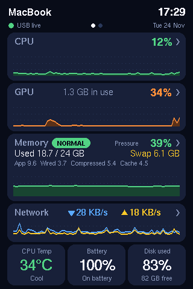
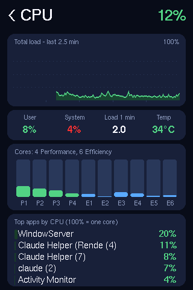
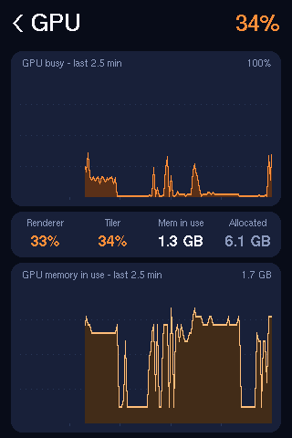
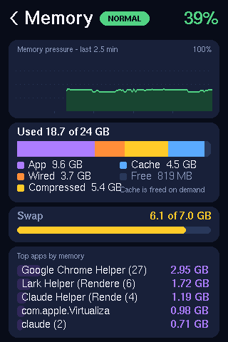
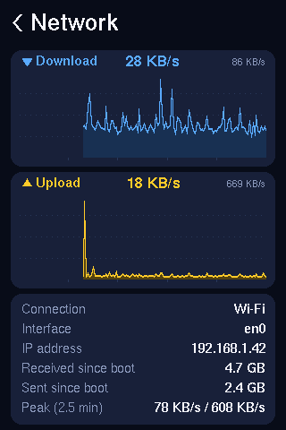

# Mac Buddy

A small USB side screen for your Mac: live CPU, GPU, memory, network, temperature, battery, disk
and Claude Code token usage on a 3.5" ESP32-S3 touch display. No Wi-Fi is needed; everything
comes over the USB-C cable.

<p align="center">
  
  
</p>

## Hardware

- **JC3248W535** board: ESP32-S3 (16 MB flash, 8 MB PSRAM), 3.5" 320×480 IPS, AXS15231B display +
  capacitive touch (QSPI display, touch on I2C 0x3B)
- A USB-C data cable to the Mac
- Tested on an Apple Silicon (M4) MacBook

## Screens

| Page | What it shows |
|---|---|
| **Overview** | CPU, GPU, memory pressure and network graphs (last 60 s); CPU temperature, battery, disk |
| **CPU** (tap card) | 2.5 min load graph, user / system, load average, temperature, per-core bars (P and E cores), top apps |
| **GPU** (tap card) | 2.5 min busy graph, renderer / tiler, GPU memory in use and allocated |
| **Memory** (tap card) | Memory pressure (Normal / Warning / Critical), App / Wired / Compressed / Cache / Free, swap, top apps |
| **Network** (tap card) | Download and upload graphs, connection type, interface, IP, totals since boot, peaks |
| **Claude Code** (swipe) | Tokens today, current 5-hour window and when it resets, output tokens per minute, by model and project |

Tap a detail page to go back. Swipe left/right on the main screen for the Claude Code page.
The screen dims when the Mac stops sending data; tap to wake it.

| Overview | CPU | GPU |
|:---:|:---:|:---:|
|  |  |  |
| **Memory** | **Network** | **Claude Code** |
|  |  |  |

Screenshots are read straight from the board's frame buffer (`mac/screenshot.sh`), taken with
`MAC_BUDDY_ANON=1` so the Mac name, IP and project names are generic.

## Setup

### 1. Flash the board

Needs [PlatformIO](https://platformio.org/):

```bash
pio run -t upload
```

`platformio.ini` uses `/dev/cu.usbmodem101`; change `upload_port` if your board shows up elsewhere.

### 2. Run the sender on the Mac

```bash
mac/run.sh
```

The first run creates `mac/.venv` and installs `psutil` and `pyserial`. Keep it running (Ctrl+C to
stop). It finds the board on USB by itself and reconnects if the cable is unplugged.

## Where the data comes from (no sudo needed)

- CPU, memory, swap, network, disk, battery: `psutil`, `vm_stat`, `sysctl`
- Memory pressure: `kern.memorystatus_vm_pressure_level` / `kern.memorystatus_level`
- CPU temperature: Apple Silicon HID temperature sensors (hottest SoC die sensor)
- GPU: `ioreg` IOAccelerator performance statistics
- Top apps: `ps`, grouped by app name
- Claude Code usage: Claude Code's local logs in `~/.claude/projects/**/*.jsonl`, read
  incrementally. Plan limits and claude.ai usage are not stored locally, so they are not shown.

## Screenshots

With the sender running:

```bash
mac/screenshot.sh
```

saves a PNG of every page (read back from the board's frame buffer) into `screenshots/`.
For pictures you want to share, start the sender with `MAC_BUDDY_ANON=1 mac/run.sh`: the Mac name,
IP address and project names are replaced with generic ones.

## Protocol

The Mac sends one JSON line per second over USB serial (115200). The board keeps 150 seconds of
history for the graphs. See `mac/mac_monitor.py` and `src/mac.cpp`.
