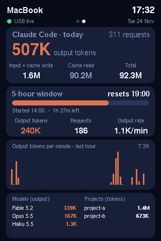

# Mac Buddy

A small USB side screen for your Mac: live CPU, GPU, memory, network, temperature, battery, disk
and Claude Code token usage on a 3.5" ESP32-S3 touch display. No Wi-Fi is needed; everything
comes over the USB-C cable.

<p align="center">
  
  
</p>

## Hardware

- **JC3248W535** board: ESP32-S3 (16 MB flash, 8 MB PSRAM), 3.5" 320×480 IPS, AXS15231B display +
  capacitive touch (QSPI display, touch on I2C 0x3B)
- A USB-C data cable to the Mac
- Tested on an Apple Silicon (M4) MacBook

## Screens

| Page | What it shows |
|---|---|
| **Overview** | CPU, GPU, memory pressure and network graphs (last 60 s); CPU temperature, battery, disk |
| **CPU** (tap card) | 2.5 min load graph, user / system, load average, temperature, per-core bars (P and E cores), top apps |
| **GPU** (tap card) | 2.5 min busy graph, renderer / tiler, GPU memory in use and allocated |
| **Memory** (tap card) | Memory pressure (Normal / Warning / Critical), App / Wired / Compressed / Cache / Free, swap, top apps |
| **Network** (tap card) | Download and upload graphs, connection type, interface, IP, totals since boot, peaks |
| **Claude Code** (swipe) | Tokens today, current 5-hour window and when it resets, output tokens per minute, by model and project |

Tap a detail page to go back. Swipe left/right on the main screen for the Claude Code page.
The screen dims when the Mac stops sending data; tap to wake it.

| Overview | CPU | GPU |
|:---:|:---:|:---:|
|  |  |  |
| **Memory** | **Network** | **Claude Code** |
|  |  |  |

Screenshots are read straight from the board's frame buffer (`mac/screenshot.sh`), taken with
`MAC_BUDDY_ANON=1` so the Mac name, IP and project names are generic.

## Step-by-step setup

About 15 minutes the first time, most of it waiting for downloads. Every command below is typed
into the **Terminal** app (Applications → Utilities → Terminal), one at a time.

### What you need

- A **JC3248W535** board (3.5" ESP32-S3 touch display). Other ESP32 boards will not work: the
  screen and pins are specific to this one.
- A USB-C cable that carries **data** (some cheap cables only charge).
- A Mac with macOS. Apple Silicon (M1 or newer) is needed for the CPU temperature.

### Step 1: Install Apple's command line tools

They include `git` and `python3`. Skip this step if `git --version` already prints a version.

```bash
xcode-select --install
```

A window opens; click **Install** and wait for it to finish.

### Step 2: Download Mac Buddy

```bash
cd ~
git clone https://github.com/arsarnc/mac-buddy.git
cd mac-buddy
```

(Or click **Code → Download ZIP** on GitHub, unzip it, and `cd` into the folder.)
Every following step runs from inside this `mac-buddy` folder.

### Step 3: Install PlatformIO (the tool that builds and flashes the firmware)

This installs it into its own folder so it doesn't touch anything else on your Mac:

```bash
python3 -m venv ~/platformio-venv
~/platformio-venv/bin/pip install platformio
```

### Step 4: Plug in the board and find its port

Connect the board to the Mac with the USB-C cable, then:

```bash
ls /dev/cu.usbmodem*
```

You should see one line such as `/dev/cu.usbmodem101`. That is the board's port; you need it in
the next step.

- **Nothing listed?** Try another cable (it may be charge-only) or another USB port.
- **Still nothing?** Unplug the board, hold its **BOOT** button, plug it back in, then let go.

### Step 5: Build and flash the firmware

Replace `/dev/cu.usbmodem101` with the port from Step 4:

```bash
~/platformio-venv/bin/pio run -t upload --upload-port /dev/cu.usbmodem101
```

The first time, PlatformIO downloads the ESP32 toolchain (several hundred MB), so this can take
5–10 minutes. It is done when you see `[SUCCESS]`.

The board restarts and shows **Mac Monitor** with "Plug this screen into your Mac". That's correct:
it is waiting for data from the Mac.

If it fails with `No serial data received`, run it again. If it keeps failing, unplug and replug
the board and try once more.

### Step 6: Start the sender on the Mac

```bash
mac/run.sh
```

The first run takes a minute: it creates `mac/.venv` and installs `psutil` and `pyserial`. Then you
should see:

```
Mac Monitor: sending stats to the ESP32 screen (Ctrl+C to stop)
Connected to /dev/cu.usbmodem101
```

Within a second the board shows the Overview page with live graphs. You're done.

### Step 7: Use it

- **Tap** the CPU, GPU, Memory or Network card for its detail page; tap again to go back.
- **Swipe** left or right on the main screen for Claude Code usage.
- **Leave the Terminal window open.** The sender only runs while it is open. If you close it, or
  press **Ctrl+C**, the screen shows "No signal" and dims after a minute.

### Every day after that

1. Plug in the board.
2. Open Terminal and run:
   ```bash
   ~/mac-buddy/mac/run.sh
   ```

You do not need to flash again. The board keeps the firmware when it is unplugged.

### Updating to a newer version

1. Stop the sender with **Ctrl+C** in its Terminal window (it holds the USB port).
2. Download the new version and flash it (use your port from Step 4):
   ```bash
   cd ~/mac-buddy
   git pull
   ~/platformio-venv/bin/pio run -t upload --upload-port /dev/cu.usbmodem101
   ```
3. Start the sender again:
   ```bash
   mac/run.sh
   ```

## Where the data comes from (no sudo needed)

- CPU, memory, swap, network, disk, battery: `psutil`, `vm_stat`, `sysctl`
- Memory pressure: `kern.memorystatus_vm_pressure_level` / `kern.memorystatus_level`
- CPU temperature: Apple Silicon HID temperature sensors (hottest SoC die sensor)
- GPU: `ioreg` IOAccelerator performance statistics
- Top apps: `ps`, grouped by app name
- Claude Code usage: Claude Code's local logs in `~/.claude/projects/**/*.jsonl`, read
  incrementally. Plan limits and claude.ai usage are not stored locally, so they are not shown.

## Screenshots

With the sender running:

```bash
mac/screenshot.sh
```

saves a PNG of every page (read back from the board's frame buffer) into `screenshots/`.
For pictures you want to share, start the sender with `MAC_BUDDY_ANON=1 mac/run.sh`: the Mac name,
IP address and project names are replaced with generic ones.

## Project layout

```
platformio.ini        board + library versions (espressif32 6.9.0, Arduino_GFX 1.4.9, U8g2, ArduinoJson 7)
src/main.cpp          screens, touch (tap / swipe), backlight dimming, screenshot service
src/mac.h, mac.cpp    stats model and the serial JSON parser
mac/run.sh            starts the sender (creates its Python venv on first run)
mac/mac_monitor.py    collects Mac stats and sends them once per second; takes screenshots on SIGUSR1
mac/claude_usage.py   reads Claude Code usage from its local logs
mac/screenshot.sh     asks the running sender to capture every page
docs/images/          screenshots used in this README
```

## Protocol

The Mac sends one JSON line per second over USB serial (115200); Claude Code usage is added every
10 seconds. The board keeps 150 seconds of history for the graphs. See `mac/mac_monitor.py` and
`src/mac.cpp`.

Screenshots use a small request/response exchange on the same port: `SHOT <page>` renders and holds
a page, `ROWS <y> <n>` returns n rows of raw RGB565 with a byte checksum, `DONE` resumes normal
drawing. Blocks are small and retried because the ESP32-S3's USB-serial output can stall briefly.

## Troubleshooting

- **Upload fails with "No serial data received"**: try again; if it keeps failing, reset the board
  over USB first, then upload:
  ```bash
  esptool --port /dev/cu.usbmodem101 --before usb-reset chip-id
  ```
  Unplugging and replugging the cable also works.
- **Screen says "No signal"**: the sender isn't running (start `mac/run.sh`), or another program
  has the serial port open.
- **Board is listed under a different port**: `ls /dev/cu.usbmodem*`, then update `upload_port` in
  `platformio.ini`. The sender picks the first `usbmodem` port by itself.
- **CPU Temp shows "n/a"**: the temperature sensors are only read on Apple Silicon Macs.

## Limitations

- macOS only (uses `ioreg`, `vm_stat`, `sysctl` and Apple Silicon sensors).
- Per-app GPU use needs admin rights, so the GPU page has no app list.
- Claude Code usage covers Claude Code only (CLI and the desktop app's Code tab). claude.ai chats
  and remaining plan limits are not available locally.
- The sender runs in a terminal; close the terminal and the screen dims after a minute.
